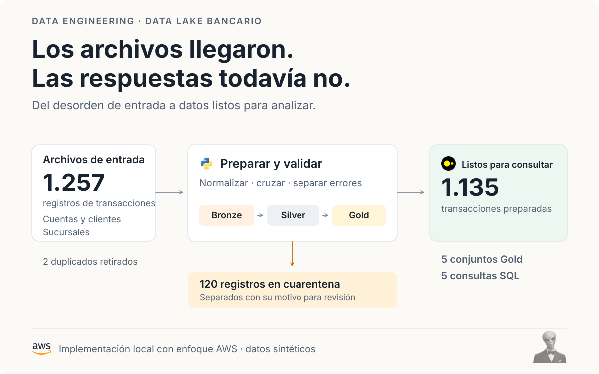
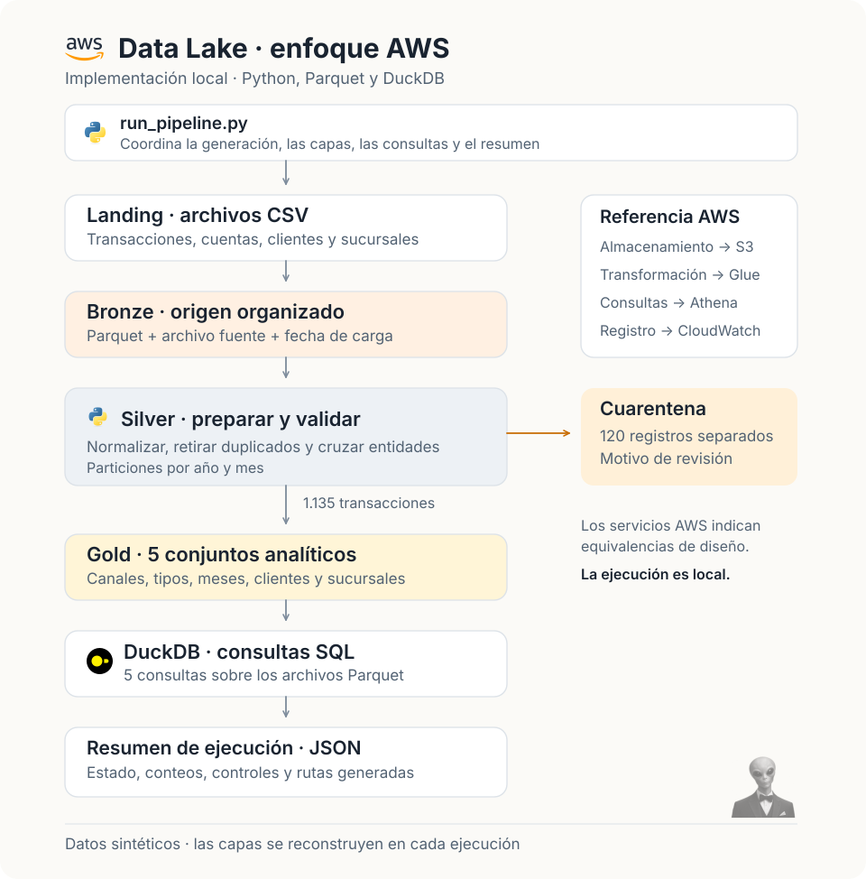

<picture>
  <source media="(prefers-color-scheme: dark)" srcset="./assets/data-lake-portada-dark.svg">
  
</picture>

## El problema de negocio

**Los archivos llegaron. Las respuestas todavía no.**

El negocio necesita comparar canales, revisar movimientos y entender qué cambió entre un mes y otro. Pero recibir los archivos de transacciones, cuentas y clientes es solo el comienzo.

Una fecha imposible deja un movimiento fuera del período correcto. Una cuenta inexistente le quita contexto a una operación. Y llamar «mobile» y «mobile_app» al mismo canal divide lo que debería analizarse junto.

Cuando cada consulta obliga a limpiar y cruzar archivos otra vez, el equipo dedica su tiempo a preparar la información antes de poder usarla.

## La solución: preparar los datos antes de analizarlos

Construí un Data Lake bancario local con enfoque AWS para darle un recorrido claro a esa información.

El proceso guarda las entradas, organiza los datos por capas y aplica controles antes de preparar las salidas analíticas. Los registros con errores críticos quedan separados, con un motivo identificado para su revisión.

Con Python preparé las transformaciones y los archivos Parquet. Con DuckDB incorporé consultas sobre canales, meses, tipos de transacción y clientes. Un único proceso coordina el recorrido y deja un resumen de lo que ocurrió.

## Los resultados y su valor para el negocio

La ejecución documentada partió de **1.257 registros de transacciones**. Se retiraron **dos duplicados**, se separaron **120 registros en cuarentena** y quedaron **1.135 transacciones preparadas**.

Con esa base se generaron **cinco conjuntos analíticos** y se ejecutaron **cinco consultas SQL**.

El aporte está en contar con datos preparados para distintas preguntas y concentrar la revisión en los casos identificados. Para el equipo, queda un recorrido que permite entender cómo se construyó cada salida.

*Implementación local con enfoque AWS, datos sintéticos y volumen controlado. Cifras documentadas de una ejecución en Codespaces.*

## Arquitectura

<picture>
  <source media="(prefers-color-scheme: dark)" srcset="./assets/arquitectura-data-lake-dark.svg">
  
</picture>

## Implementación

<strong>De los archivos al análisis</strong>

Cada etapa prepara la siguiente: organizar el origen, separar los problemas y dejar datos que permitan responder preguntas.

| Etapa y tecnología | Problema | Cómo lo resolví y qué aporta |
|---|---|---|
| **Preparar las entradas**  Python | Necesitaba comprobar qué ocurría con archivos correctos y con errores. | Generé CSV de transacciones, cuentas, clientes y sucursales con casos controlados para probar el recorrido. |
| **Organizar el origen** Parquet · Bronze | Los archivos necesitaban una estructura común y una referencia a su procedencia. | Normalicé columnas y guardé Parquet con archivo fuente y fecha de carga, manteniendo una base cercana a la entrada. |
| **Revisar y relacionar**  Python · Silver | Duplicados, fechas inválidas y cuentas inexistentes podían distorsionar el análisis. | Apliqué validaciones, separé errores en cuarentena y enriquecí las transacciones con cuentas, clientes y sucursales. |
| **Preparar las salidas** Parquet · Gold | Las transacciones individuales requerían agregaciones para comparar el negocio. | Construí cinco conjuntos por canal, tipo de transacción, mes, cliente y sucursal. |
| **Consultar y registrar**  DuckDB | Las salidas debían permitir responder preguntas y conocer cómo terminó el proceso. | Ejecuté cinco consultas SQL y guardé resultados y resúmenes JSON con estados, conteos y rutas. |

<strong>Cómo construí el proyecto, paso a paso</strong>

Estos son los archivos y carpetas que sostienen el recorrido.

| Paso y código | Tecnología | Problema → solución |
|---|---|---|
| **1. Preparar los casos** [Generador de entradas](./app/generate_banking_landing_data.py) |  Python | Necesitaba datos de prueba reproducibles → definí una semilla fija y casos con duplicados, valores vacíos y referencias inválidas. |
| **2. Separar las etapas** [data_lake/](./data_lake/) | CSV · Parquet | Mezclar entrada y resultados dificultaba seguir el dato → organicé Landing, Bronze, Silver y Gold. |
| **3. Transformar y validar** [Construcción de las capas](./app/build_data_lake.py) |  Python | Los archivos requerían reglas comunes → centralicé limpieza, cruces, cuarentena, particiones y agregaciones. |
| **4. Definir las preguntas** [Consultas analíticas](./queries/athena_like_queries.sql) | SQL | Las salidas debían responder preguntas concretas → separé las consultas por canal, mes, tipo, cliente y período. |
| **5. Ejecutar las consultas** [Motor de consulta](./app/run_athena_like_queries.py) |  DuckDB | Necesitaba consultar Parquet y guardar lo obtenido → ejecuté SQL y generé resultados CSV y un resumen JSON. |
| **6. Coordinar el recorrido** [Ejecución completa](./app/run_pipeline.py) |  Python | Las etapas necesitaban una secuencia y un cierre → coordiné generación, transformación, consultas y resumen de ejecución. |

*Los datos y resúmenes se generan localmente; por eso las carpetas de salida contienen solo archivos de estructura en GitHub. Cada ejecución regenera las entradas y reconstruye las capas.*

<strong>Las pruebas detrás de las cifras</strong>

Estos resultados corresponden a la ejecución local documentada en Codespaces. El código permite identificar los controles y seguir la conciliación de filas.

| Control | Resultado documentado | Qué aporta |
|---|---|---|
| **Entrada** | **1.257 registros de transacciones** | Un punto de partida para comparar qué continuó y qué se separó. |
| **Calidad** | **2 duplicados retirados · 120 en cuarentena** | Separar los casos que no deben alimentar las salidas analíticas. |
| **Silver** | **1.135 transacciones preparadas** | Una base relacionada con cuentas, clientes y sucursales. |
| **Gold** | **5 conjuntos analíticos** | Salidas para analizar canales, tipos, meses, clientes y sucursales. |
| **Consultas** | **5/5 ejecutadas** | SQL sobre Parquet para explorar los datos preparados. |
| **Cierre** | Estado final **PASSED** | Registro de que el recorrido terminó sin excepciones en esa ejecución. |

**Las filas cuadran: 1.257 = 2 duplicados + 120 en cuarentena + 1.135 preparadas.**

*Las consultas ejecutadas son comprobaciones de ejecución, no una suite de pruebas automatizadas. El [detalle de las cifras](./docs/resultados-documentados.md) distingue los resultados históricos y lo comprobable en el código.*

<strong>Cómo lo cuento en una entrevista técnica</strong>

> Partí de archivos bancarios con errores para construir un Data Lake local con enfoque AWS. Usé Python para preparar las capas, retirar duplicados y separar registros inválidos. Guardé los datos en Parquet y utilicé DuckDB para consultar las salidas.
>
> En la ejecución documentada, de 1.257 registros quedaron 1.135 transacciones preparadas, 120 en cuarentena y dos duplicados retirados. Generé cinco conjuntos analíticos y ejecuté cinco consultas. El aporte es tener una base preparada para analizar y un recorrido claro para explicar qué ocurrió con los datos.

[Volver al portafolio](../README.md#portafolio-inicio) · [Ejecutar el proyecto y profundizar](./docs/guia-tecnica.md)
