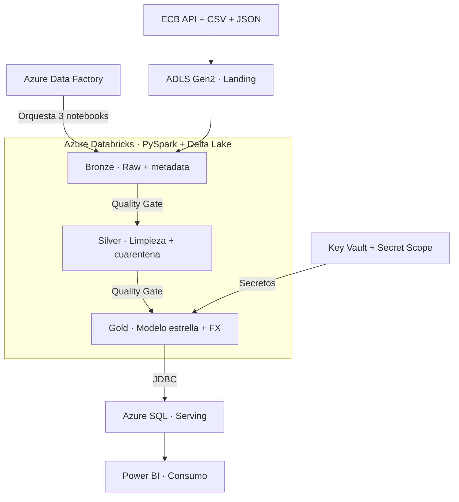

# Pipeline bancario en Azure


**El pipeline terminó en verde. El reporte podía seguir estando mal.**

Una ejecución exitosa no garantiza que las cifras sean correctas. Una transacción duplicada puede inflar un total; una cuenta inexistente puede dejar movimientos sin relacionar; una tasa de cambio ausente puede impedir comparar monedas.

En un reporte bancario, esos detalles cambian la lectura de los resultados. Por eso, el desafío de este proyecto fue controlar la calidad durante todo el recorrido de los datos, desde los archivos originales hasta Power BI.

## El problema: las fuentes llegan separadas, el análisis las necesita juntas

Las transacciones llegan en CSV, los clientes y las cuentas en JSON, y los tipos de cambio desde una API del Banco Central Europeo. Cada fuente aporta una pieza, pero reunirlas exige comprobar que sus identificadores, relaciones y monedas sean consistentes.

También hay una pregunta operativa: **¿qué pasa si necesitamos ejecutar el proceso otra vez?** Volver a recibir los mismos datos no debería volver a sumar las mismas operaciones.

## La solución: controles antes de que el dato llegue al reporte

Construí una plataforma bancaria multimoneda en Azure que conserva los datos originales, valida la información y prepara un modelo para su análisis.

El flujo comienza en ADLS Gen2. Databricks procesa los datos con PySpark y Delta Lake en tres capas: **Bronze conserva el origen, Silver limpia y valida, y Gold aplica las reglas de negocio.** Los registros inválidos se separan en cuarentena y las transacciones válidas se convierten a EUR con la tasa correspondiente.

Azure Data Factory coordina los tres notebooks y sus dependencias. Al finalizar, los datos se publican en Azure SQL y Power BI permite analizar clientes, cuentas, transacciones y canales.

## El valor: que una nueva carga no cambie la historia

Repetir una publicación es una situación normal: puede ser necesario recuperar una ejecución o volver a procesar un archivo. Si el flujo vuelve a insertar los mismos movimientos, el reporte empieza a contar operaciones que nunca ocurrieron.

Por eso, una de las decisiones centrales fue diseñar **cargas que reconocen la información ya procesada** y comprobar que los registros y sus relaciones se mantengan consistentes.

La trazabilidad permite seguir el recorrido desde el origen. La cuarentena mantiene identificados los registros que necesitan revisión. La reconciliación comprueba que los datos cuadren antes de utilizarlos en el análisis.

**El resultado es un flujo que permite investigar un error y repetir el proceso conservando la consistencia de la información.**

## Objetivos: conectar, validar y entregar

El proyecto se construyó con cuatro objetivos: **integrar archivos y API en un mismo flujo; proteger la calidad antes del consumo; repetir las cargas sin duplicar; y entregar un modelo listo para Power BI.**

La seguridad y el costo también forman parte del diseño: las credenciales se gestionan fuera del código y los recursos cuentan con medidas de control de consumo.

## La arquitectura detrás del resultado

La información avanza por etapas con responsabilidades definidas. Primero se conserva el origen, después se validan los registros y finalmente se aplican las reglas del modelo analítico.



**Bronze conserva la evidencia.** Mantiene el dato recibido junto con información técnica para seguir su recorrido.

**Silver controla la calidad.** Normaliza tipos, elimina duplicados y separa registros inválidos en cuarentena.

**Gold prepara la lectura del negocio.** Aplica la conversión a EUR y organiza dimensiones y transacciones en un modelo estrella.

Data Factory ejecuta los tres notebooks en orden. Azure SQL recibe las tablas preparadas y Power BI las utiliza para explorar movimientos, clientes, cuentas y canales. Esta separación ayuda a localizar dónde ocurrió un problema y qué etapa revisar.

## La prueba decisiva: publicar de nuevo

La primera ejecución completó el recorrido. La segunda puso a prueba una condición distinta: recibir los mismos datos sin volver a escribirlos.

**El resultado fue 953 filas antes, 953 después y cero escrituras nuevas.** La publicación terminó como `NO_OP`: no había cambios que aplicar.

También se verificó que las relaciones entre tablas fueran válidas y que la información pudiera consumirse desde Power BI.

**Resultados comprobados en el proyecto:**

- **Flujo completo:** tres notebooks ejecutados correctamente en **10 min 17 s**.
- **Integridad:** validaciones PK/FK **7/7**, con **cero registros huérfanos**.
- **Reejecución:** **953 → 953 filas**, sin escrituras nuevas.
- **Consumo analítico:** modelo de Power BI con **siete tablas y seis relaciones activas**.

Estas comprobaciones se realizaron con datos sintéticos y volúmenes controlados. Demuestran el comportamiento de la implementación; no corresponden a una prueba de rendimiento a escala ni a resultados comerciales de un cliente.

## La confianza en el reporte empieza antes del dashboard

El proyecto conecta ingesta, transformación, calidad y publicación en un recorrido comprobable. Cada control responde a una pregunta concreta: de dónde viene el dato, si puede utilizarse y qué ocurre cuando se procesa otra vez.

**Un pipeline aporta valor cuando podemos confiar en lo que entrega y explicar cómo llegó hasta ahí.**

## Implementación y evidencias

<details>
<summary><strong>Ver todas las métricas y el alcance de las validaciones</strong></summary>

| Métrica | Resultado |
|---|---:|
| Ejecución ADF | 3/3 notebooks correctos en 10 min 17 s |
| Publicación Azure SQL | 7 tablas y 953 filas |
| Integridad | PK/FK 7/7 y 0 registros huérfanos |
| Reconciliación | `PASSED` |
| Segunda publicación | `NO_OP`: 953 → 953 y 0 escrituras |
| Modelo Power BI | 7 tablas y 6 relaciones activas |
| KPI validados | 8 transacciones, 4 clientes y 6 cuentas |
| Distribución por canal | Card 3, Mobile 2, Online 2 y ATM 1 |
| Pruebas locales | 42/42 controles de fixtures y 37/37 pruebas |
| Costo observado | USD 0,04; proyección USD 0,29 |
| Control presupuestario | USD 2 mensuales y alerta al 50 % |

Los volúmenes son controlados y buscan demostrar diseño, calidad e idempotencia; no representan una prueba de rendimiento a escala.

</details>


<details>
<summary><strong>Ver etapas, decisiones técnicas, seguridad y control de costos</strong></summary>

| Etapa | Implementación | Decisión técnica |
|---|---|---|
| Ingesta | ECB API, transacciones CSV y clientes/cuentas JSON hacia ADLS | Separar origen y procesamiento para conservar trazabilidad |
| Bronze | Datos raw, schemas explícitos y metadata de auditoría | Preservar fidelidad del origen antes de transformar |
| Silver | Limpieza, tipificación, deduplicación, dominios y cuarentena | Evitar que datos inválidos lleguen al modelo analítico |
| Gold | Conversión a EUR, reconciliación y modelo estrella | Centralizar reglas de negocio y facilitar consumo |
| ADF | Pipeline `pl_project23_medallion_orchestration` con tres notebooks secuenciales | Separar orquestación de transformación distribuida |
| Azure SQL | Siete tablas en el esquema `serving` | Entregar una capa estable para herramientas BI |
| Seguridad | Azure Key Vault y Databricks Secret Scope | Mantener credenciales JDBC fuera del código |
| Operación | Autoapagado, SQL pausado, presupuesto y alerta | Controlar explícitamente el costo cloud |

Modelo de serving:

`dim_date` · `dim_customer` · `dim_account` · `dim_merchant` · `dim_channel` · `dim_currency` · `fact_transaction`

</details>

<details>
<summary><strong>Explorar la estructura del código</strong></summary>

```text
23-azure-adf-databricks-bank-fx/
├── adf/                         # Diseño ADF local versionado
├── config/                      # Configuración Silver y Gold
├── contracts/                   # Contratos de datos
├── data/fixtures/               # Datos sintéticos válidos e inválidos
├── databricks/notebooks/        # Notebooks portables por capa
├── docs/                        # Arquitectura, cloud, evidencias y operación
├── scripts/                     # Ejecución, auditoría y validación local
├── sql/                         # Consultas analíticas sobre Gold
├── src/                         # Ingesta, transformaciones Silver y Gold
├── tests/                       # Suite automatizada local
└── README.md
```

Los datos son sintéticos y el repositorio no contiene credenciales, correos, endpoints completos ni identificadores sensibles.

</details>

<details>
<summary><strong>Consultar la documentación y los anexos</strong></summary>

- [Arquitectura y decisiones técnicas](docs/architecture.md)
- [Implementación end-to-end](docs/cloud_implementation.md)
- [Runbook operativo y de costos](docs/operations_and_cost_runbook.md)
- [Catálogo y alcance de evidencias](docs/evidence_catalog.md)
- [Convenciones de nombres y regiones](docs/naming_and_tagging.md)
- [Anexo — Cómo contar este proyecto en una entrevista](docs/interview_guide.md)

Las pruebas automatizadas corresponden a la implementación local versionada. Las validaciones de ADF, Azure SQL, Power BI y costos fueron comprobaciones manuales cloud. Las capturas se mantienen fuera del repositorio público.

</details>

[Volver al portafolio](../README.md)
