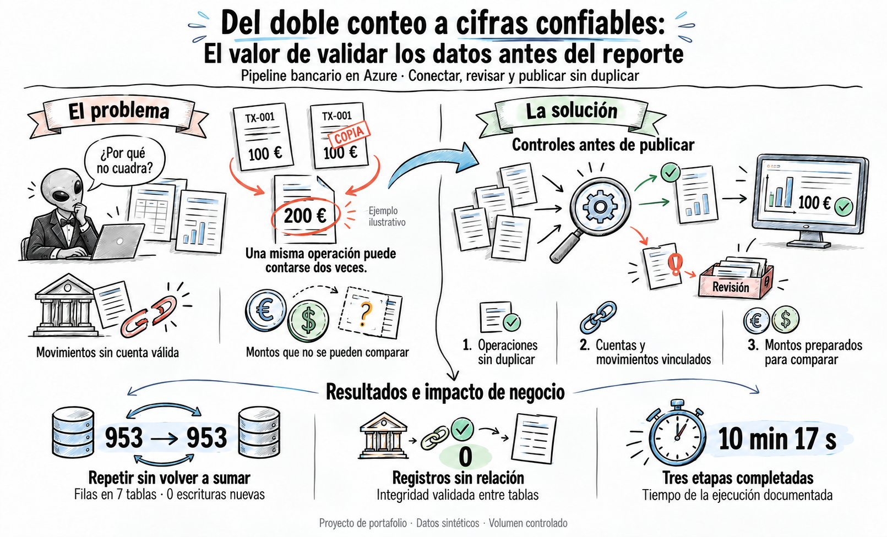
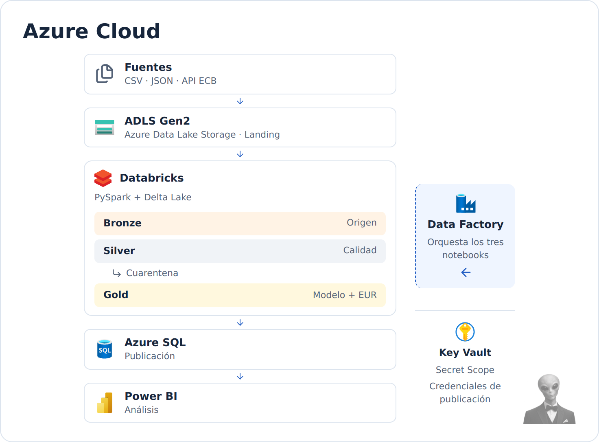

## El problema de negocio

**Cuando las cifras no cuadran, el negocio termina esperando.**

En un cierre de gestión, el equipo necesita entender cuánto dinero se movió, por qué canales y en qué monedas. Si los reportes entregan cifras distintas, la conversación termina girando alrededor de cuál está bien.

Una operación de 100 € que aparece dos veces puede convertirse en 200 €. Una cuenta inexistente puede dejar movimientos fuera del análisis. Y comparar monedas sin una conversión consistente puede llevar a conclusiones equivocadas.

Resolver esas diferencias obliga a revisar archivos y reconstruir cálculos. El análisis del negocio queda esperando.

## La solución: resolver las diferencias antes del reporte

Con ese escenario como punto de partida, construí un pipeline bancario en Azure con Databricks que conecta las fuentes y revisa la información antes de publicarla.

El proceso conserva los datos originales, comprueba duplicados y relaciones, y convierte los montos a una moneda común. Los registros que necesitan atención quedan separados, con su motivo identificado.

Así, el equipo cuenta con un recorrido para investigar una diferencia y una base común para analizar movimientos, clientes y canales.

También incorporé una condición práctica: repetir una carga con los mismos datos debe conservar el resultado.

## Los resultados y su valor para el negocio

La publicación dejó **siete tablas y 953 filas totales**, con sus relaciones validadas y **cero registros huérfanos**.

Al publicar nuevamente, se mantuvieron **953 filas y hubo cero escrituras nuevas**. Repetir el proceso conservó las cifras.

Los tres notebooks coordinados completaron su ejecución en **10 min 17 s**.

Estos controles permiten concentrar la revisión en los casos identificados, explicar el origen de una cifra y repetir una publicación sin duplicar operaciones.

Para el negocio, el aporte está en disponer de información consistente para comparar canales y montos. Para el equipo, en tener un camino claro para responder cuando alguien pregunta de dónde salió un resultado.

Proyecto validado con datos sintéticos y volumen controlado.

## Arquitectura

<picture>
  <source media="(prefers-color-scheme: dark)" srcset="./docs/images/arquitectura-azure-dark.png">
  
</picture>

## Implementación

<strong>De los archivos al análisis</strong>

Para llegar a cifras consistentes, cada etapa resolvió una parte del problema: conservar el origen, controlar los errores y comprobar que el resultado pudiera publicarse y repetirse.

| Etapa | Problema | Cómo lo resolví y qué aporta |
|---|---|---|
| **Conservar el origen**  ADLS Gen2 | La información llegaba en distintos formatos y desde varias fuentes. | Centralicé los archivos y conservé los originales para poder investigar de dónde salió una cifra. |
| **Preparar los datos**  Databricks | Duplicados, relaciones inválidas y distintas monedas podían distorsionar el análisis. | Apliqué validaciones, separé errores en cuarentena y convertí los montos a EUR, preparando una base consistente para comparar movimientos y canales. |
| **Conectar las etapas**  Data Factory | Cada transformación necesitaba el resultado correcto de la anterior. | Coordiné tres notebooks en secuencia, con dependencias de éxito para controlar el avance del proceso. |
| **Comprobar la entrega**  Azure SQL | Publicar datos incompletos o duplicarlos al repetir una carga cambiaría las cifras. | Validé relaciones y reconcilié Gold con SQL. La segunda publicación conservó el resultado sin nuevas escrituras. |
| **Mostrar el resultado**  Power BI | Las tablas necesitaban una forma clara de consulta. | Relacioné el modelo y publiqué indicadores de transacciones, clientes, cuentas y canales para facilitar su lectura. |

<strong>Las pruebas detrás de las cifras</strong>

El cierre fue comprobar que los datos cuadraran, las relaciones fueran válidas y repetir el proceso conservara el resultado.

| Control | Resultado | Qué aporta |
|---|---|---|
| **Orquestación** | 3/3 notebooks correctos en **10 min 17 s** | Un recorrido completo con ejecución y duración registradas. |
| **Publicación** | **7 tablas · 953 filas** | Una base común disponible para el análisis. |
| **Integridad** | PK/FK **7/7** y **0 huérfanos** | Movimientos vinculados con sus dimensiones para analizarlos correctamente. |
| **Reconciliación** | **PASSED** entre Gold y SQL | Comprobar que las cifras se conservaron al publicarlas. |
| **Idempotencia** | **953 → 953 · 0 escrituras nuevas** | Repetir una publicación sin duplicar operaciones. |
| **Pruebas locales** | **37/37 aprobadas** | Reglas de procesamiento verificadas con pruebas automatizadas. |

*Validado con datos sintéticos y volumen controlado. Las comprobaciones cloud fueron manuales.*

<strong>Cómo organicé el proyecto</strong>

La lógica, los notebooks y las pruebas están separados para poder revisar cómo se transforma un dato y qué controles debe superar.

| Carpeta | Su papel en el proyecto |
|---|---|
| [data/fixtures/](./data/fixtures/) | Datos sintéticos válidos e inválidos para probar el flujo. |
| [config/](./config/) | Configuración de fuentes y parámetros de Silver y Gold. |
| [src/](./src/) | Reglas de ingesta, limpieza, conversión de monedas y reconciliación. |
| [databricks/notebooks/](./databricks/notebooks/) | Notebooks portables para ejecutar y validar las capas. |
| [adf/](./adf/) | Diseño local de la ingesta y sus conexiones. |
| [tests/](./tests/) | Pruebas automatizadas de calidad, transformaciones y repetición de cargas. |
| [sql/](./sql/) | Consultas para analizar los movimientos del modelo Gold. |

*La carpeta `adf/` contiene el diseño local; la exportación del pipeline cloud definitivo no está versionada.*

[Volver al portafolio](../README.md)
