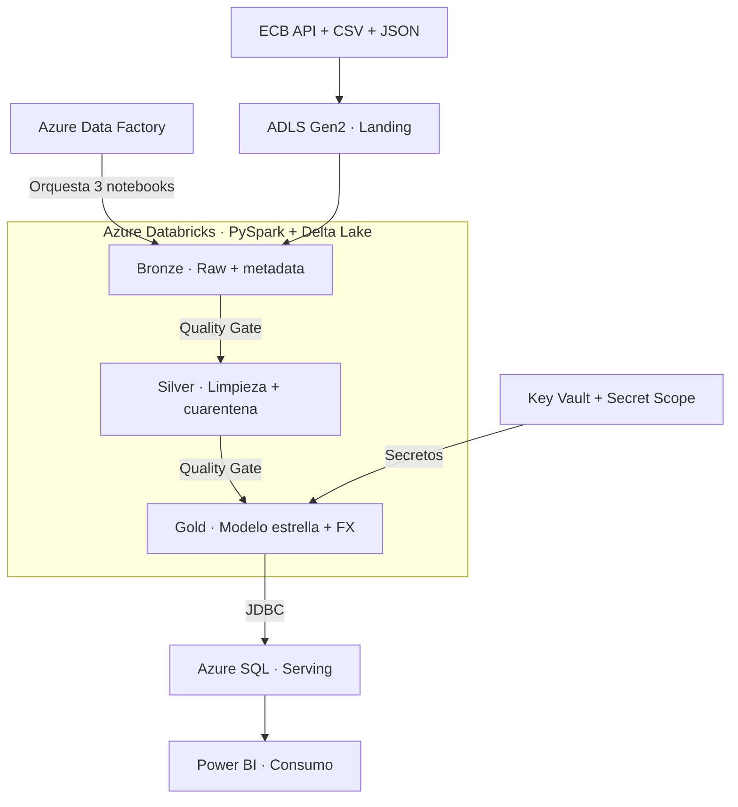

# Pipeline bancario en Azure

> **La misma transacción dos veces. El doble de problemas.**

Una transacción llega en un CSV, el cliente aparece en un JSON y el tipo de cambio viene de una API. Para analizarlos juntos, primero hay que comprobar que las piezas encajen: que la cuenta exista, que la moneda tenga una tasa disponible y que el movimiento no esté duplicado.

Este proyecto parte de ese desafío: **conectar información bancaria y mantenerla confiable durante todo su recorrido hasta Power BI.** Es una implementación de portafolio con datos sintéticos y volúmenes controlados, ejecutada en Azure.

## El problema que quería resolver

Reprocesar un archivo no debería volver a sumar sus transacciones. Tampoco debería llegar al reporte un movimiento asociado a una cuenta inexistente o convertido sin una tasa de cambio disponible.

El desafío fue construir un flujo único y trazable que detectara esos casos, separara los registros inválidos y permitiera repetir la ejecución sin duplicar información.

## Objetivos

- **Conectar las fuentes:** integrar transacciones CSV, clientes y cuentas JSON y tipos de cambio de la API del Banco Central Europeo.
- **Proteger la calidad:** validar los datos por etapas, separar errores y comprobar que los registros y los totales cuadren.
- **Repetir sin duplicar:** permitir reejecuciones seguras y dejar registro del recorrido de los datos.
- **Facilitar el análisis:** publicar un modelo estrella en Azure SQL para Power BI, con credenciales y costos bajo control.

## Qué construí y qué valor aporta

Implementé un pipeline que recibe archivos y tipos de cambio en ADLS Gen2, conserva los datos originales y los transforma por etapas con Databricks, PySpark y Delta Lake. Azure Data Factory coordina las ejecuciones y la información validada se publica en Azure SQL para su consumo desde Power BI.

El valor está en **automatizar la preparación de los datos, concentrar las reglas de negocio y poder comprobar cómo se obtuvo cada resultado.**

Por ejemplo, una transacción válida se relaciona con su cliente y cuenta y se convierte a EUR con la tasa correspondiente. Un registro inválido se separa para revisión. Al repetir la publicación con los mismos datos, el resultado se mantiene sin nuevas escrituras.

## Arquitectura implementada



Flujo ejecutado:

1. **Landing:** recibe CSV, JSON y tasas de cambio del ECB en ADLS Gen2.
2. **Bronze:** conserva el dato original con metadata técnica y trazabilidad.
3. **Silver:** tipifica, normaliza, deduplica y separa registros inválidos en cuarentena.
4. **Gold:** aplica conversión multimoneda y construye dimensiones más tabla de hechos.
5. **Orquestación:** ADF ejecuta los tres notebooks en orden y controla sus dependencias.
6. **Serving:** Databricks publica siete tablas en Azure SQL mediante JDBC seguro.
7. **Consumo:** Power BI utiliza el modelo estrella para métricas de clientes, cuentas, transacciones y canales.

**Cada capa tiene una responsabilidad:** Bronze conserva el origen; Silver limpia y valida; Gold aplica las reglas de negocio y prepara el modelo analítico. Esta separación permite revisar dónde ocurrió un problema sin mezclar todas las transformaciones.

## Resultados: qué comprobé

**La prueba clave fue ejecutarlo otra vez sin duplicar los datos.**

| Comprobación | Resultado |
|---|---|
| ¿Terminó el flujo completo? | ADF ejecutó los 3 notebooks correctamente en **10 min 17 s**. |
| ¿Las relaciones eran válidas? | Validaciones PK/FK **7/7**, con **0 registros huérfanos**. |
| ¿Qué ocurrió al publicar otra vez? | **953 → 953 filas**, con **0 escrituras nuevas** (`NO_OP`). |
| ¿Quedó listo para analizar? | Modelo de Power BI con **7 tablas y 6 relaciones activas**. |

Estos resultados corresponden a las pruebas del proyecto; los volúmenes controlados permiten verificar diseño, calidad e idempotencia.

<details>
<summary><strong>Ver todas las métricas y el alcance de las validaciones</strong></summary>

| Métrica | Resultado |
|---|---:|
| Ejecución ADF | 3/3 notebooks correctos en 10 min 17 s |
| Publicación Azure SQL | 7 tablas y 953 filas |
| Integridad | PK/FK 7/7 y 0 registros huérfanos |
| Reconciliación | `PASSED` |
| Segunda publicación | `NO_OP`: 953 → 953 y 0 escrituras |
| Modelo Power BI | 7 tablas y 6 relaciones activas |
| KPI validados | 8 transacciones, 4 clientes y 6 cuentas |
| Distribución por canal | Card 3, Mobile 2, Online 2 y ATM 1 |
| Pruebas locales | 42/42 controles de fixtures y 37/37 pruebas |
| Costo observado | USD 0,04; proyección USD 0,29 |
| Control presupuestario | USD 2 mensuales y alerta al 50 % |

Los volúmenes son controlados y buscan demostrar diseño, calidad e idempotencia; no representan una prueba de rendimiento a escala.

</details>

## Cómo lo implementé

<details>
<summary><strong>Ver etapas, decisiones técnicas, seguridad y control de costos</strong></summary>

| Etapa | Implementación | Decisión técnica |
|---|---|---|
| Ingesta | ECB API, transacciones CSV y clientes/cuentas JSON hacia ADLS | Separar origen y procesamiento para conservar trazabilidad |
| Bronze | Datos raw, schemas explícitos y metadata de auditoría | Preservar fidelidad del origen antes de transformar |
| Silver | Limpieza, tipificación, deduplicación, dominios y cuarentena | Evitar que datos inválidos lleguen al modelo analítico |
| Gold | Conversión a EUR, reconciliación y modelo estrella | Centralizar reglas de negocio y facilitar consumo |
| ADF | Pipeline `pl_project23_medallion_orchestration` con tres notebooks secuenciales | Separar orquestación de transformación distribuida |
| Azure SQL | Siete tablas en el esquema `serving` | Entregar una capa estable para herramientas BI |
| Seguridad | Azure Key Vault y Databricks Secret Scope | Mantener credenciales JDBC fuera del código |
| Operación | Autoapagado, SQL pausado, presupuesto y alerta | Controlar explícitamente el costo cloud |

Modelo de serving:

`dim_date` · `dim_customer` · `dim_account` · `dim_merchant` · `dim_channel` · `dim_currency` · `fact_transaction`

</details>

<details>
<summary><strong>Explorar la estructura del código</strong></summary>

```text
23-azure-adf-databricks-bank-fx/
├── adf/                         # Diseño ADF local versionado
├── config/                      # Configuración Silver y Gold
├── contracts/                   # Contratos de datos
├── data/fixtures/               # Datos sintéticos válidos e inválidos
├── databricks/notebooks/        # Notebooks portables por capa
├── docs/                        # Arquitectura, cloud, evidencias y operación
├── scripts/                     # Ejecución, auditoría y validación local
├── sql/                         # Consultas analíticas sobre Gold
├── src/                         # Ingesta, transformaciones Silver y Gold
├── tests/                       # Suite automatizada local
└── README.md
```

Los datos son sintéticos y el repositorio no contiene credenciales, correos, endpoints completos ni identificadores sensibles.

</details>

## Documentación para profundizar

- [Arquitectura y decisiones técnicas](docs/architecture.md)
- [Implementación end-to-end](docs/cloud_implementation.md)
- [Runbook operativo y de costos](docs/operations_and_cost_runbook.md)
- [Catálogo y alcance de evidencias](docs/evidence_catalog.md)
- [Convenciones de nombres y regiones](docs/naming_and_tagging.md)
- [Anexo — Cómo contar este proyecto en una entrevista](docs/interview_guide.md)

Las pruebas automatizadas corresponden a la implementación local versionada. Las validaciones de ADF, Azure SQL, Power BI y costos fueron comprobaciones manuales cloud. Las capturas se mantienen fuera del repositorio público.

[Volver al portafolio](../README.md)
