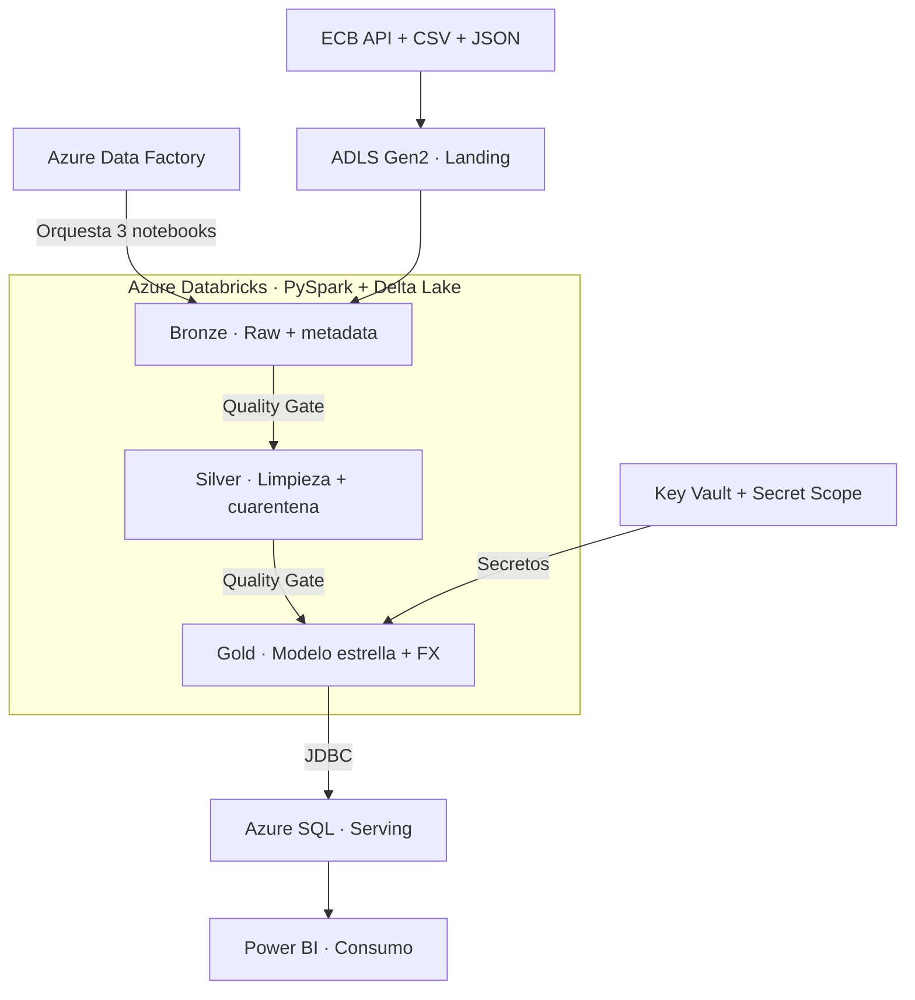

# Pipeline bancario en Azure


**El pipeline terminó en verde. El reporte podía seguir estando mal.**

Una operación de $100 registrada dos veces aparece como $200 en el reporte. El proceso puede terminar sin errores y, aun así, entregar una cifra incorrecta.

Ese es el problema que aborda este proyecto: reunir transacciones, cuentas, clientes y tipos de cambio, comprobar que los datos sean consistentes y llevarlos hasta un reporte que permita explicar sus resultados.

## El problema: las fuentes llegan separadas, el negocio necesita una sola lectura

Para analizar los movimientos de un banco, no basta con juntar archivos. Cada operación debe vincularse con una cuenta válida y los montos deben expresarse en una moneda comparable.

Si una transacción se repite, el total se infla. Si falta su cuenta, se pierde parte del contexto. Si falta el tipo de cambio, la comparación queda incompleta.

Y cuando es necesario repetir una carga, los mismos movimientos deben seguir contando una sola vez.

## La solución: revisar los datos antes de convertirlos en cifras

Construí un flujo que conserva los archivos originales, revisa la información y separa los registros que necesitan atención antes de publicarlos para su análisis.

### Operaciones sin duplicar

El proceso reconoce los datos ya publicados. Volver a ejecutar una carga con la misma información no agrega otra vez los mismos movimientos.

### Cuentas y movimientos vinculados

Los controles comprueban las relaciones entre los registros. Los datos inválidos se separan en cuarentena para revisarlos sin mezclarlos con la información preparada para el reporte.

### Montos preparados para comparar

Las operaciones válidas se convierten a EUR utilizando el tipo de cambio correspondiente. Así, los movimientos en distintas monedas comparten una misma base de análisis.

## Impacto de negocio: cifras consistentes y resultados que se pueden explicar

La prueba central fue publicar los mismos datos una segunda vez: **953 filas antes, 953 después y cero escrituras nuevas**. El resultado fue `NO_OP`: no había cambios que aplicar.

| Resultado comprobado | Qué aporta al análisis |
|---|---|
| Segunda publicación sin escrituras nuevas | Evita agregar nuevamente la misma información |
| Validaciones PK/FK 7/7 y cero registros huérfanos | Mantiene las relaciones entre las tablas publicadas |
| Conversión de montos a EUR | Permite comparar operaciones sobre una moneda común |
| Siete tablas y seis relaciones activas en Power BI | Conecta movimientos, clientes, cuentas y canales |

**Las 953 filas corresponden al total de siete tablas; no son 953 transacciones.** El reporte validado contiene ocho transacciones, cuatro clientes y seis cuentas.

Estos resultados se comprobaron con datos sintéticos y volúmenes controlados. El impacto descrito corresponde a los controles demostrados por el proyecto; no mide ahorros ni resultados comerciales de un banco.

## El valor: poder explicar y repetir el resultado

La trazabilidad permite seguir el dato desde su origen. La cuarentena identifica lo que necesita revisión. La reconciliación comprueba que la información publicada cuadre con los datos preparados.

Juntos, estos controles permiten investigar una diferencia y repetir el proceso conservando la consistencia de las cifras.

## Objetivos: conectar, validar y entregar

- Integrar transacciones, cuentas, clientes y tipos de cambio en un mismo flujo.
- Detectar datos inválidos antes de su consumo analítico.
- Repetir las cargas sin duplicar la información publicada.
- Entregar un modelo relacionado y listo para Power BI.

La seguridad y el costo también forman parte del diseño: las credenciales se gestionan fuera del código y los recursos cuentan con medidas de control de consumo.

## La arquitectura detrás del resultado

La información avanza por etapas con responsabilidades definidas. Primero se conserva el origen, después se validan los registros y finalmente se aplican las reglas del modelo analítico.



**Bronze conserva la evidencia.** Mantiene el dato recibido junto con información técnica para seguir su recorrido.

**Silver controla la calidad.** Normaliza tipos, elimina duplicados y separa registros inválidos en cuarentena.

**Gold prepara la lectura del negocio.** Aplica la conversión a EUR y organiza dimensiones y transacciones en un modelo estrella.

Data Factory ejecuta los tres notebooks en orden. Azure SQL recibe las tablas preparadas y Power BI las utiliza para explorar movimientos, clientes, cuentas y canales. Esta separación ayuda a localizar dónde ocurrió un problema y qué etapa revisar.

La ejecución de los tres notebooks orquestados por Data Factory se completó en **10 min 17 s**. Esta duración corresponde a esa ejecución documentada y no representa una prueba de rendimiento a escala.

## Implementación y evidencias

<details>
<summary><strong>Ver todas las métricas y el alcance de las validaciones</strong></summary>

| Métrica | Resultado |
|---|---:|
| Ejecución ADF | 3/3 notebooks correctos en 10 min 17 s |
| Publicación Azure SQL | 7 tablas y 953 filas |
| Integridad | PK/FK 7/7 y 0 registros huérfanos |
| Reconciliación | `PASSED` |
| Segunda publicación | `NO_OP`: 953 → 953 y 0 escrituras |
| Modelo Power BI | 7 tablas y 6 relaciones activas |
| KPI validados | 8 transacciones, 4 clientes y 6 cuentas |
| Distribución por canal | Card 3, Mobile 2, Online 2 y ATM 1 |
| Pruebas locales | 42/42 controles de fixtures y 37/37 pruebas |
| Costo observado | USD 0,04; proyección USD 0,29 |
| Control presupuestario | USD 2 mensuales y alerta al 50 % |

Los volúmenes son controlados y buscan demostrar diseño, calidad e idempotencia; no representan una prueba de rendimiento a escala.

</details>


<details>
<summary><strong>Ver etapas, decisiones técnicas, seguridad y control de costos</strong></summary>

| Etapa | Implementación | Decisión técnica |
|---|---|---|
| Ingesta | ECB API, transacciones CSV y clientes/cuentas JSON hacia ADLS | Separar origen y procesamiento para conservar trazabilidad |
| Bronze | Datos raw, schemas explícitos y metadata de auditoría | Preservar fidelidad del origen antes de transformar |
| Silver | Limpieza, tipificación, deduplicación, dominios y cuarentena | Evitar que datos inválidos lleguen al modelo analítico |
| Gold | Conversión a EUR, reconciliación y modelo estrella | Centralizar reglas de negocio y facilitar consumo |
| ADF | Pipeline `pl_project23_medallion_orchestration` con tres notebooks secuenciales | Separar orquestación de transformación distribuida |
| Azure SQL | Siete tablas en el esquema `serving` | Entregar una capa estable para herramientas BI |
| Seguridad | Azure Key Vault y Databricks Secret Scope | Mantener credenciales JDBC fuera del código |
| Operación | Autoapagado, SQL pausado, presupuesto y alerta | Controlar explícitamente el costo cloud |

Modelo de serving:

`dim_date` · `dim_customer` · `dim_account` · `dim_merchant` · `dim_channel` · `dim_currency` · `fact_transaction`

</details>

<details>
<summary><strong>Explorar la estructura del código</strong></summary>

```text
23-azure-adf-databricks-bank-fx/
├── adf/                         # Diseño ADF local versionado
├── config/                      # Configuración Silver y Gold
├── contracts/                   # Contratos de datos
├── data/fixtures/               # Datos sintéticos válidos e inválidos
├── databricks/notebooks/        # Notebooks portables por capa
├── docs/                        # Arquitectura, cloud, evidencias y operación
├── scripts/                     # Ejecución, auditoría y validación local
├── sql/                         # Consultas analíticas sobre Gold
├── src/                         # Ingesta, transformaciones Silver y Gold
├── tests/                       # Suite automatizada local
└── README.md
```

Los datos son sintéticos y el repositorio no contiene credenciales, correos, endpoints completos ni identificadores sensibles.

</details>

<details>
<summary><strong>Consultar la documentación y los anexos</strong></summary>

- [Arquitectura y decisiones técnicas](docs/architecture.md)
- [Implementación end-to-end](docs/cloud_implementation.md)
- [Runbook operativo y de costos](docs/operations_and_cost_runbook.md)
- [Catálogo y alcance de evidencias](docs/evidence_catalog.md)
- [Convenciones de nombres y regiones](docs/naming_and_tagging.md)
- [Anexo — Cómo contar este proyecto en una entrevista](docs/interview_guide.md)

Las pruebas automatizadas corresponden a la implementación local versionada. Las validaciones de ADF, Azure SQL, Power BI y costos fueron comprobaciones manuales cloud. Las capturas se mantienen fuera del repositorio público.

</details>

[Volver al portafolio](../README.md)
