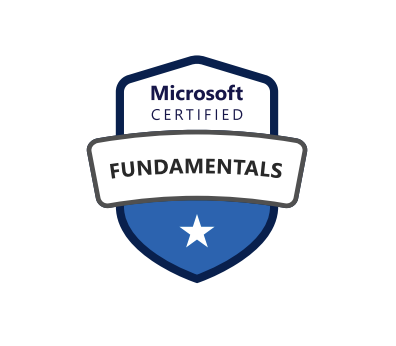
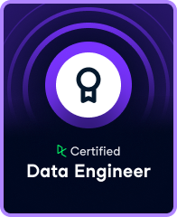

# Portafolio de Ingeniería de Datos

Soy Ingeniero Civil Industrial con especialización en Analítica de Negocios y más de cuatro años de experiencia en datos.

**Me apasiona la ingeniería de datos: conectar información, automatizar procesos y construir soluciones confiables.** Trabajo por hitos, priorizo según impacto y urgencia, y colaboro con equipos de negocio y tecnología con comunicación clara.

He participado en proyectos de satisfacción de clientes, telemedicina, biometría facial, transacciones digitales y clasificación de RUT y giros con información del SII.

En este portafolio comparto cómo abordo problemas de integración, automatización y calidad de datos. **Más abajo encontrarás mis tres proyectos destacados.**

En [AvanzaPyme](https://avanzapyme.cl/), junto a excompañeros de universidad, asesoro a pymes de la región en finanzas e indicadores, automatizo procesos contables y desarrollo sistemas ERP.

En la empresa familiar [Taller Café](https://taller.cafe/), diseño interiores, layouts, planos 2D y 3D y flujos de circulación para cafeterías de especialidad con Autodesk Maya 2027, Python y apoyo de IA.

 

## Proyectos destacados

| Proyecto | De qué trata | Tecnologías |
|---|---|:---:|
| **[Plataforma bancaria en Azure](./23-azure-adf-databricks-bank-fx/README.md#azure-inicio)** | **La misma transacción dos veces. El doble de problemas.** Un pipeline que detecta duplicados y valida los datos antes de publicarlos. |  &nbsp;  &nbsp;  |
| **[Data Lake bancario con enfoque AWS](./20-aws-style-banking-data-lake/README.md#aws-inicio)** | **Un Data Lake necesita más que espacio para guardar cosas.** Una implementación local con enfoque AWS que prepara los datos y separa los errores antes del análisis. | <picture><source media="(prefers-color-scheme: dark)" srcset="./assets/icons/aws-dark.svg"></picture> &nbsp;  &nbsp;  |
| **[Clasificación de RUT y giros — SII](./rut-classification-data-quality-case/clasificacion-calidad-datos-presentacion.pdf)** | **Clasificar empresas no debería ser una adivinanza.** Reglas claras y trazabilidad para entender cómo se obtuvo cada clasificación. |  |

## Certificaciones

| [Microsoft Certified: Azure Fundamentals (AZ-900)](https://learn.microsoft.com/es-mx/users/franciscosalas-0966/credentials/certification/azure-fundamentals) | [DataCamp: Data Engineer](https://www.datacamp.com/certificate/DE0019458875218) |
|:---:|:---:|
|  |  |

<strong>Lecturas que inspiran mi trabajo</strong>

- **Fundamentos de ingeniería de datos** — Joe Reis y Matt Housley.
- **Diseño de aplicaciones intensivas en datos** — Martin Kleppmann.
- **Ingeniería de IA** — Chip Huyen.

## Contacto y CV

[LinkedIn](https://www.linkedin.com/in/francisco-javier-salas-605431200/) · [Email](mailto:franciscosalaspla@gmail.com) · [CV español](./CV_Francisco_Salas_Data_Engineer.pdf) · [CV inglés](./CV_Francisco_Salas_Data_Engineer_EN.pdf)
